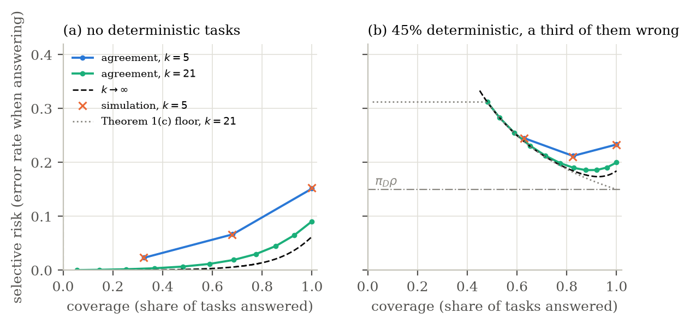

# Confidently wrong

[](https://github.com/Pearmaleka/confidently-wrong/actions/workflows/ci.yml)

**Limits of sampling-based confidence for abstaining LLM agents.** A technical note
([PDF](paper/note.pdf)) with proofs, plus code that checks every closed form by simulation.

A cheap way to tell whether an LLM agent might be wrong is to run it several times and see whether
the runs agree: self-consistency, semantic entropy and their relatives. The note studies the whole
class of such *label-invariant* scores, the ones that depend only on which runs agree with which,
and shows exactly what they cannot do.

## Results

Let $\pi_D$ be the share of tasks on which the agent is deterministic and $\rho$ the share of those
it gets wrong (its systematic errors).

- **Profile sufficiency (Lemma 1).** Given the agent's output distribution on a task, a
  label-invariant score is independent of whether the agent's favourite answer is the correct one.
- **The deterministic blind spot (Theorem 1).** Any abstention policy that trusts unanimity at
  least as much as anything else has selective risk at least $\pi_D\rho$, at every coverage, for
  every number of runs. Threshold policies have risk at least $\pi_D\rho/\max(c, P(U))$; any policy
  at all has risk at least $\rho\,(c-(1-\pi_D))_+/c$.
- **Certification (Corollary 1, Proposition 3).** If $\pi_D\rho > \alpha$, no calibration procedure
  can certify risk $\alpha$ with such policies, however much labelled data it has: a valid procedure
  abstains on everything. Otherwise the certifiable coverages form a window
  $[\pi_D\rho/\alpha,\ (1-\mu)/(1-\alpha)]$, which can be empty.
- **Honest confidence (Corollary 2).** A calibrated confidence built from agreement must state
  $1-\rho$ on every deterministic task; its Brier score there cannot fall below $\rho(1-\rho)$.
- **Binary model (Proposition 1).** Closed-form risk–coverage curves. As the number of runs grows,
  agreement reveals how strongly the agent prefers an answer, $|2A-1|$, but never whether the
  preferred answer is right, $\mathrm{sign}(2A-1)$.
- **Breaking the floor (Proposition 2).** A second source helps if and only if it agrees with the
  agent's wrong answers less often than with its right ones.
- **Evaluation (Proposition 4).** With $k$ runs per task the variance of an error-rate estimate is
  inflated by $1 + (k-1)\,\mathrm{ICC}$; a nominal 95% interval that counts runs as independent
  covers 62% of the time at $k = 5$ when all errors are systematic. The same intra-task correlation
  measures how much of the error is invisible to resampling.



With deterministic tasks (right panel), the curve is inverted: the unanimous answers of a 21-run
agent are wrong 31% of the time, against 20% for answering everything, and no policy gets below
$\pi_D\rho = 0.15$.

## Reproducing

```bash
pip install -e ".[dev]"
pytest                                  # every closed form against Monte Carlo
python experiments/make_figures.py      # figures and experiments/results.json
cd paper && latexmk -pdf note.tex       # the note
```

```
paper/note.tex           the note (theorems, proofs, discussion)
src/cwrong/binary.py     binary model: exact risk-coverage curves, limits, floors
src/cwrong/certify.py    fixed-sequence binomial certification, sample-size rule
src/cwrong/evaluation.py design effect, naive-CI coverage, run allocation, ICC estimate
src/cwrong/simulate.py   Monte Carlo counterparts
tests/test_theory.py     Theorem 1 on random populations and policies; every proposition by simulation
```

## Status

A technical note, not peer reviewed. All numbers come from synthetic populations; estimating
$\pi_D$, $\rho$ and the ICC on real agent benchmarks with several runs per task is the next step.

## Citation

```bibtex
@techreport{le2026confidently,
  title       = {Confidently Wrong: Limits of Sampling-Based Confidence for Abstaining {LLM} Agents},
  author      = {Le, Nam Khanh},
  institution = {The Hong Kong Polytechnic University},
  type        = {Technical note},
  year        = {2026},
  url         = {https://github.com/Pearmaleka/confidently-wrong}
}
```

## License

MIT
